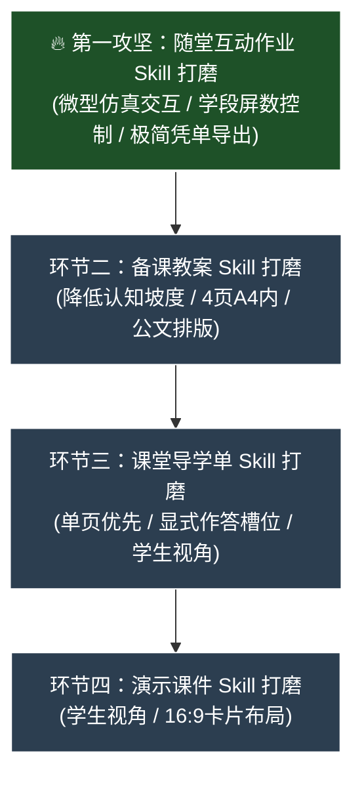

# IT Lesson Studio - 工作上下文与交接文档 (AGENTS.md)

> **给接手项目的 AI Assistant**：  
> 本项目已完成工程基建、Docker 部署与分支整理。当前主要任务是：**逐步打磨四个教学环节的 Skills，使生成的内容符合一线教学实际。**

---

## 1. 项目背景与交付物

- **定位**：面向浙江省中小学（小学 3~6 年级、初中 7~8 年级）信息科技教师的备课辅助工具。
- **四个教学环节**（具体规格以 [references/output-spec.md](references/output-spec.md) 为准）：
  1. **备课教案**：`.md` 编译为 `.docx`（四列表格、控制在 4 页 A4 内、无板书设计、包含生活比喻与设问话术）。
  2. **课堂导学单**：`.md` 编译为 `.docx`（单页优先、学生第一视角、无机房座号、含显式作答槽位）。
  3. **演示课件**：`.md` 编译为 `.pptx` 与 `.pdf`（Marp `edu-lesson` 16:9 主题、卡片布局、学生视角）。
  4. **随堂互动作业**：单文件 HTML（离线可用、微型仿真交互与即时判分、导出 `.txt` 学习凭单、通关奖状卡）。
- **基本要求**：
  - **任务同源**：同一节课的情境、任务名称与各环节作业对应一致。
  - **使用门槛低**：作业单文件离线可用，凭单文本可直接上传教学平台。
  - **符合学段特点**：遵循 2022 新课标，低年级不出现抽象代码术语。

---

## 2. 参考文档

生成或修改教学内容时参考以下文件：
1. [references/curriculum-standard-2022.md](references/curriculum-standard-2022.md)：教育部《义务教育信息科技课程标准（2022年版）》。
2. [references/textbook-zj2026.md](references/textbook-zj2026.md)：浙教版 2026 新课标教材目录（3~8 年级，共 240 课时）。
3. [references/output-spec.md](references/output-spec.md)：字数、页数、屏数、题数阈值与排版规格。
4. [references/worksheet-patterns.md](references/worksheet-patterns.md) 与 [references/patterns.md](references/patterns.md)：导学单与互动作业交互题型库。

---

## 3. 核心工具与命令

- **主 Skill**：`skills/it-lesson-studio/SKILL.md`
- **样式与模板**：
  - Word 模板与 Lua 过滤器：`resources/pandoc/模板.docx`、`resources/pandoc/br.lua`
  - Marp 演示课件主题：`resources/themes/edu-lesson.css`
- **编译导出流水线**：
  ```bash
  node scripts/export-lesson.mjs <课程目录或Markdown文件路径>
  ```
- **合规自检脚本**（Python 执行统一使用 `uv run python`）：
  ```bash
  uv run python scripts/check_lesson.py <课例目录 或 作业HTML 或 导学单Markdown>
  ```
- **标杆课例自检**：
  ```bash
  uv run python scripts/check_lesson.py examples/
  ```

---

## 4. 分支说明与前期概况

### 分支约定
- **`main` 分支**：Docker 服务器版，运行在内网或云端（如 `192.168.2.99:3800`），含多用户、鉴权与管理后台，不包含 Windows 便携脚本。
- **`feature/standalone-portable` 分支**：Windows 便携离线版，包含独立运行时与一键启动脚本。

### 前期已完成事项
- Word 排版处理（跨 Run `[ ]` 替换、四列表格跨页、缩进处理）。
- Web 界面与 Docker 容器化配置。
- 三年级、六年级、八年级标杆课例落地（位于 `examples/`，自检 0 FAIL / 0 WARN）。

---

## 5. 任务规划：随堂互动作业优先攻坚

> **教学实际出发的核心原则**：  
> 一线信息科技课在机房开展，教案与课件多用于备课检查与开场几分钟引入；**课堂 40 分钟实际运转、学生动手探究与学习评价的真正核心载体是「随堂互动作业」**。  
> 因此，必须将**随堂互动作业作为第一优先级攻坚打磨**，再反向拉动课件、导学单与教案的协同。



---

### 🔥 核心任务：随堂互动作业 (HTML Classwork) 打磨（进行中）
- **优化目标**：告别“纯文字点单选题”的伪交互，针对浙教版各类课型打造学生真正能动手玩、能试错探究、能即时反馈并无感上传教学平台的单文件 HTML 应用。
- **具体攻坚任务**：
  1. **按浙教版核心课型分类梳理微型仿真器模式库**：
     - **硬件感知课**（如《了解智能工具》、《寻找智能“小眼睛”》）：磁吸卡片连线、芯片高亮解剖台、键鼠动作模拟；
     - **网络与在线课**（如《进入在线平台》、《下载平台资源》、《关注网络痕迹》）：模拟浏览器地址栏/寻址沙箱、文件下载进度沙箱、隐私安全辨析；
     - **算法思维课**（如《算法的执行》、《分支结构》、《生活中的决策》）：流程图卡片拖拽拼图、单步变量追踪表（“人肉CPU”）、分支条件切换器；
     - **数据与编码课**（如《从数据到编码》、《数据解密》）：开关与二进制转换、凯撒移位转盘、校验码排雷。
  2. **学段认知阶梯与屏数防疲劳控制**：
     - 3~4 年级：严格 ≤4 屏，测验 ≤2 题，文字极简，大按钮大触控；
     - 5~6 年级：严格 ≤5 屏，测验 ≤3 题，支持参数调节与流程推演；
     - 7~8 年级：严格 ≤6 屏，测验 ≤3 题，支持单步调试与代码变量追踪。
  3. **终极关卡与平台评价闭环**：
     - **测验统一提交判分**：先选后判，提交后锁定并显示正误解析与总分横幅；
     - **徽章墙与成就感**：根据前续关卡操作表现动态点亮徽章；
     - **自评出口保护**：必留“我还没完全懂，需要老师或同伴帮助”选项；
     - **一键极简无感导出**：不弹窗拦截打字慢的孩子，免输姓名直接秒下 `.txt` 凭单（首行 `# 班级|姓名|课题|得分|时间`，直传之江汇/省教学平台）；
     - **现场通关奖状卡**：炫酷弹窗展示学习成就。
  4. **两阶段生成 Pipeline 提示词与骨架加固**：
     - 调优 `web/services/ai.js` 中的 Phase 2 专属生成提示词与内置 CSS/JS 健壮性，确保大模型生成的 JS 0 语法报错、0 依赖外部网络。
  5. **课型生成实测与自检回归**：
     - 选取代表性课例实测生成 HTML，并使用 `uv run python scripts/check_lesson.py` 严格校验 0 FAIL / 0 WARN。

---

### 环节二：备课教案 (Lesson Plan) 打磨（后续协同）
- **优化目标**：紧扣互动作业的任务关卡，提供生活比喻、设问话术、上机避坑锦囊，4页 A4 内。

---

### 环节三：课堂导学单 (Worksheet) 打磨（后续协同）
- **优化目标**：单页 A4 优先，轻量配合机房实操，显式槽位，不跨页挂孤行。

---

### 环节四：演示课件 (Marp Slides) 打磨（后续协同）
- **优化目标**：16:9 卡片布局，纯净学生视角，一页一任务，开场前几分钟高效导引。

---

## 6. 测试与验证命令

完成技能优化后，使用以下命令检查：

```powershell
# 1. 检查标杆课例合规性
uv run python scripts/check_lesson.py examples/

# 2. 检查 Word 排版真实页数 (教案<=4页, 导学单1页)
uv run python scripts/verify_layout.py examples/三年级上/第02课_了解智能工具/

# 3. 运行完整编译导出
node scripts/export-lesson.mjs examples/三年级上/第02课_了解智能工具/
```
