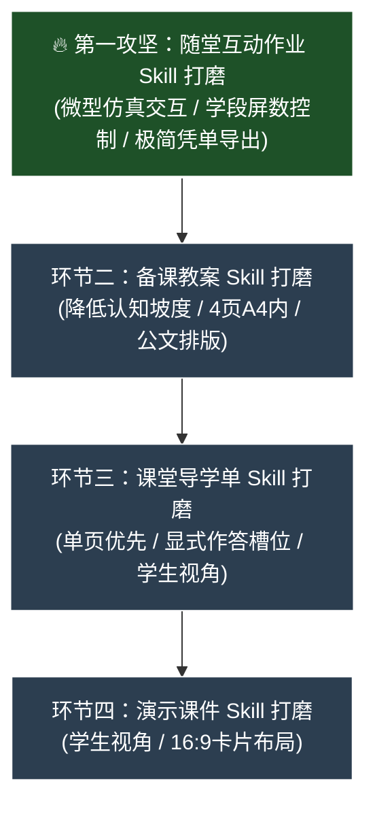

# IT Lesson Studio - 工作上下文与交接文档 (AGENTS.md)

> **给接手项目的 AI Assistant**：  
> 本项目已完成工程基建、Docker 部署与分支整理。当前主要任务是：**逐步打磨四个教学环节的 Skills，使生成的内容符合一线教学实际。**

---

## 1. 项目背景与交付物

- **定位**：面向浙江省中小学（小学 3~6 年级、初中 7~8 年级）信息科技教师的备课辅助工具。
- **四个教学环节**（具体规格以 [references/output-spec.md](references/output-spec.md) 为准）：
  1. **备课教案**：`.md` 编译为 `.docx`（四列表格、控制在 4 页 A4 内、无板书设计、包含生活比喻与设问话术）。
  2. **课堂导学单**：`.md` 编译为 `.docx`（单页优先、学生第一视角、无机房座号、含显式作答槽位）。
  3. **演示课件**：`.md` 编译为 `.pptx` 与 `.pdf`（Marp `edu-lesson` 16:9 主题、卡片布局、学生视角）。
  4. **随堂互动作业**：单文件 HTML（离线可用、微型仿真交互与即时判分、导出 `.txt` 学习凭单、通关奖状卡）。
- **基本要求**：
  - **任务同源**：同一节课的情境、任务名称与各环节作业对应一致。
  - **使用门槛低**：作业单文件离线可用，凭单文本可直接上传教学平台。
  - **符合学段特点**：遵循 2022 新课标，低年级不出现抽象代码术语。

---

## 2. 参考文档

生成或修改教学内容时参考以下文件：
1. [references/curriculum-standard-2022.md](references/curriculum-standard-2022.md)：教育部《义务教育信息科技课程标准（2022年版）》。
2. [references/textbook-zj2026.md](references/textbook-zj2026.md)：浙教版 2026 新课标教材目录（3~8 年级，共 240 课时）。
3. [references/output-spec.md](references/output-spec.md)：字数、页数、屏数、题数阈值与排版规格。
4. [references/worksheet-patterns.md](references/worksheet-patterns.md) 与 [references/patterns.md](references/patterns.md)：导学单与互动作业交互题型库。

---

## 3. 核心工具与命令

- **主 Skill**：`skills/it-lesson-studio/SKILL.md`
- **样式与模板**：
  - Word 模板与 Lua 过滤器：`resources/pandoc/模板.docx`、`resources/pandoc/br.lua`
  - Marp 演示课件主题：`resources/themes/edu-lesson.css`
- **编译导出流水线**：
  ```bash
  node scripts/export-lesson.mjs <课程目录或Markdown文件路径>
  ```
- **合规自检脚本**（Python 执行统一使用 `uv run python`）：
  ```bash
  uv run python scripts/check_lesson.py <课例目录 或 作业HTML 或 导学单Markdown>
  ```
- **标杆课例自检**：
  ```bash
  uv run python scripts/check_lesson.py examples/
  ```

---

## 4. 分支说明与前期概况

### 分支约定
- **`main` 分支**：Docker 服务器版，运行在内网或云端（如 `192.168.2.99:3800`），含多用户、鉴权与管理后台，不包含 Windows 便携脚本。
- **`feature/standalone-portable` 分支**：Windows 便携离线版，包含独立运行时与一键启动脚本。

### 前期已完成事项
- Word 排版处理（跨 Run `[ ]` 替换、四列表格跨页、缩进处理）。
- Web 界面与 Docker 容器化配置。
- 三年级、六年级、八年级标杆课例落地（位于 `examples/`，自检 0 FAIL / 0 WARN）。

---

## 5. 任务规划：随堂互动作业优先攻坚

> **教学实际出发的核心原则**：  
> 一线信息科技课在机房开展，教案与课件多用于备课检查与开场几分钟引入；**课堂 40 分钟实际运转、学生动手探究与学习评价的真正核心载体是「随堂互动作业」**。  
> 因此，必须将**随堂互动作业作为第一优先级攻坚打磨**，再反向拉动课件、导学单与教案的协同。



---

### 🔥 核心任务：随堂互动作业 (HTML Classwork) 打磨（进行中）
- **核心定位升维**：从“课后 5 分钟小练习”升级为**“支撑课堂 35~40 分钟动手运转的数字化探究舱 (Inquiry Workspace)”**。学生进机房以互动作业为主线自主探究，教师巡视辅导。
- **总体设计原则**：
  1. **容量与时长支撑 40 分钟课堂运转**：
     - 标准结构：破冰痛点体验 ➔ 核心仿真调节 ➔ 进阶挑战 ➔ 迁移演练 ➔ 评价凭单；
     - 分层保底与防早退：设置“基础通关”与“进阶挑战星”，快学生有得钻研、慢学生稳步达标，撑满整堂课的教学活力。
  2. **学科化精准输入（少打字，精打字）**：
     - 杜绝折磨学生的长篇文字小作文；
     - 紧扣学科认知练输入：低段练按键/拼音/文件名，中段练二进制/分支判断条件/参数，高段练变量名/单行代码表达式。
  3. **难度衡量摆脱机械数屏数**：
     - 难度的本质是“思维深度与探究时间跨度”，绝非机械数屏数；
     - 低段采取小步快跑、轻量多节点切换（大触控、强正向反馈）；
     - 高段采取大任务、深探究、长驻留（单屏内具备代码沙箱、变量表、多组测试用例，可深度调试 15~20 分钟）。
- **核心规则：教师设想绝对优先 (Teacher Customization First)**：
  - **最高优先级**：如果教师在“教学设想与特别说明”中输入了具体想法、特色情境（如测温枪、垃圾分类、自动售货机）或机房软硬件限制，**AI 必须 100% 优先以教师设想为核心量身定制关卡与仿真器**，绝不机械照搬课本默认案例！
  - **智能启发与兜底**：仅在教师留空未填设想时，系统才依据下述“12 册教材能力映射库”提供该学段认知水准的典型仿真范式（作为能力天花板与启发支架，而非写死的死板条框）。

- **浙教版 12 册教材能力进阶与仿真器启发范式（教师未指定设想时的兜底参考）**：
  - **三上（感知智能 + 在线入门）**：部件高亮解剖台、虚拟浏览器下载排雷沙箱、文件分类箱；
  - **三下（多媒体 + AI初体验）**：图片滤镜裁剪滑块、音频波形淡入淡出调节、AI提示词联想生成台；
  - **四上（数据 + 生活编码）**：二进制开关灯泡阵列、条形码生成器、动态统计图表；
  - **四下（数字化底层 + 校验）**：像素点阵取色板、ASCII 对照转盘、奇偶校验排雷矩阵；
  - **五上（算法思维 + 流程图分支）**：流程图卡片拼图槽、红绿灯/道闸分支条件切换器、生活决策树；
  - **五下（控制系统 + 循环）**：恒温箱/自动浇花阈值仿真、循环计数累加步进器；
  - **六上（代码实现 + 经典算法）**：单步代码追踪器（人肉CPU）、二分猜数字对战、枚举步进表；
  - **六下（反馈控制 + 逻辑运算门）**：双开关串并联逻辑门电路（与/或）、水箱闭环反馈沙箱；
  - **七上（网络底层 + 拓扑搭建）**：局域网连线与 IP 分配器、数据包逐跳路由动画、HTML实时预览；
  - **七下（物联网 + 图搜索算法）**：传感器折线波动监控台、迷宫 DFS 递归寻路步进回溯动画器；
  - **八上（DOM数据 + 密码安全）**：凯撒密码移位转盘、网页 DOM 树节点探针、密码散列防伪；
  - **八下（AI原理级拆解）**：2D 平面 KNN 动态分类面（加点动态画线）、卷积核滤波、神经网络权重计算。
- **具体攻坚任务**：
  1. ✅ **模式库代码沉淀**：已在 `references/patterns.md` 与 `skills/it-lesson-studio/SKILL.md` 中沉淀 12 册教材典型微型仿真器原生 JS 组件库与数字化探究舱规范；
  2. ✅ **生成引擎 Phase 2 升级**：已在 `web/services/ai.js` 中实现 `resolveSimulationBlueprint`（支持教师设想最高优先级 + 课题关键词识别 12 册仿真原型与状态机骨架注入）与 `getGradeLimits`（严格对齐 `output-spec.md` 门禁参数）；
  3. ✅ **终极关卡与平台评价闭环**：内置 `sanitizeGeneratedClassworkHtml` 静态合规微调器，保障测验先选后判、累计徽章点亮、含“还没完全懂”自评、零 `alert` 拦截一键秒下凭单 `.txt` 与现场通关奖状卡；
  4. 🔄 **课型生成实测与真机试玩**：选取代表性课例实测生成，进浏览器全流程试玩体验手感，并通过 `check_lesson.py` 自动化检测。

---

### 环节二：备课教案 (Lesson Plan) 打磨（后续协同）
- **优化目标**：紧扣互动作业的任务关卡，提供生活比喻、设问话术、上机避坑锦囊，4页 A4 内。

---

### 环节三：课堂导学单 (Worksheet) 打磨（后续协同）
- **优化目标**：单页 A4 优先，轻量配合机房实操，显式槽位，不跨页挂孤行。

---

### 环节四：演示课件 (Marp Slides) 打磨（后续协同）
- **优化目标**：16:9 卡片布局，纯净学生视角，一页一任务，开场前几分钟高效导引。

---

## 6. 测试与验证命令

完成技能优化后，使用以下命令检查：

```powershell
# 1. 检查标杆课例合规性
uv run python scripts/check_lesson.py examples/

# 2. 检查 Word 排版真实页数 (教案<=4页, 导学单1页)
uv run python scripts/verify_layout.py examples/三年级上/第02课_了解智能工具/

# 3. 运行完整编译导出
node scripts/export-lesson.mjs examples/三年级上/第02课_了解智能工具/
```
