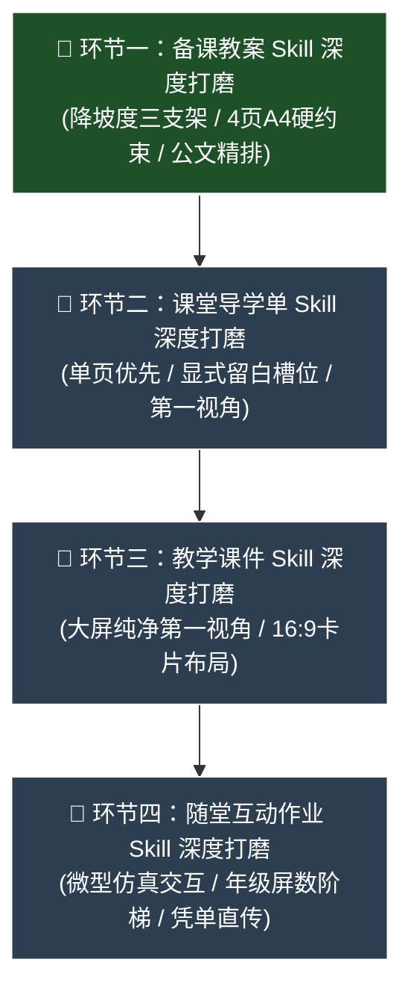

# IT Lesson Studio - AI Agent 工作上下文与交接备忘录 (AGENTS.md)

> **致进入本项目的下一个 AI Assistant**：  
> 请务必在开始工作前完整阅读本文档。  
> 本项目已全面完成工程基建、容器化部署与双分支架构隔离。**当前项目唯一核心战略任务是：“一个一个深度打磨四大环节的 Skills 引擎，让输出成果真正具备浙江省一线特级教师/教研员‘进机房能直接上课’的高水准”。**

---

## 1. 项目核心背景与使命

- **项目定位**：专为浙江省中小学（小学 3~6 年级、初中 7~8 年级）信息科技教师打造的**“四位一体”极速教学工作台**。
- **四大核心教学交付物**（规范口径以 `references/output-spec.md` 为唯一准绳）：
  1. **备课教案 (Lesson Plan)**：`.md` 编译为 `.docx`（公文精排四列表格、严格 ≤4 页 A4 双面刚好 2 张纸、彻底取消板书、降坡度三大支架）。
  2. **探究导学单 (Worksheet)**：`.md` 编译为 `.docx`（单页优先 · 上限封顶 · 严禁凑页注水、学生第一视角、取消座号、显式留白槽位与闭合网格）。
  3. **演示课件 (Marp Slides)**：`.md` 编译为 `.pptx` 与 `.pdf`（Marp `edu-lesson` 16:9 现代大屏主题、卡片双栏网格布局、纯净学生第一视角）。
  4. **随堂互动作业 (HTML Classwork)**：**单文件原生 HTML 互动作业**（断网秒开、微型仿真与即时判分、一键导出 `.txt` 学习凭单无缝上传中小学信息科技与人工智能平台、现场生成电子通关奖状卡）。
- **三大核心原则**：
  - **四位一体同源强咬合**：同一节课的情境、任务、课件与作业仿真关卡必须 100% 同名同源呼应，杜绝割裂。
  - **平台联动与开箱即用**：互动作业采用单文件架构，凭单 `.txt` 直传中小学信息科技平台，无需繁琐部署。
  - **素养与学段对齐**：紧扣 2022 新课标四大素养，严格遵守年级认知阶梯，小学低段严禁出现死记硬背代码或过于抽象的术语。

---

## 2. 权威依据与知识库索引（必须严格遵守）

AI 在生成、修改或审计任何教学内容时，必须以此四份文档为最高准绳：
1. 📘 **[references/curriculum-standard-2022.md](references/curriculum-standard-2022.md)**：
   - 教育部《义务教育信息科技课程标准（2022年版）》全文。
   - 核心素养（信息意识、计算思维、数字化学习与创新、信息社会责任）、学段目标、学业质量标准。
2. 📗 **[references/textbook-zj2026.md](references/textbook-zj2026.md)**：
   - 浙教版 2026 新课标最新教材目录图谱（从之江汇官方教学平台实时校验同步）。
   - 覆盖 3~8 年级共 6 个年级、12 个册次、46 个单元、240 个课时（已彻底剔除 9 年级老旧内容）。
3. 📙 **[references/output-spec.md](references/output-spec.md)**：
   - 四大环节字数、页数、屏数、题数阈值与排版规则的**唯一权威口径**。
4. 📙 **[references/worksheet-patterns.md](references/worksheet-patterns.md)** 与 **[references/patterns.md](references/patterns.md)**：
   - 导学单题型模式库与课堂互动作业仿真交互模式库。

---

## 3. 核心工具链与质量门禁命令

- **Master Skill 定义**：`skills/it-lesson-studio/SKILL.md`
- **样式与模板核心**：
  - Word 模板与 Lua 过滤器：`resources/pandoc/模板.docx`、`resources/pandoc/br.lua`
  - Marp 演示课件主题：`resources/themes/edu-lesson.css`
- **自动化导出流水线**：
  ```bash
  node scripts/export-lesson.mjs <课程目录或Markdown文件路径>
  ```
  *(注：脚本串联 Pandoc 与 Marp CLI 编译，自动调用 `scripts/beautify_docx.py` 实现中文公文级精排)*
- **全链路合规自检脚本**（Python 执行必须遵循用户规则 `uv run python`）：
  ```bash
  uv run python scripts/check_lesson.py <课例目录 或 作业HTML 或 导学案Markdown>
  ```
- **标杆全库一键门禁全检**：
  ```bash
  uv run python scripts/check_lesson.py examples/   # 必须保持 0 FAIL / 0 WARN
  ```

---

## 4. 架构隔离与历史里程碑（已全部闭环）

### 🏛️ 双版本分支铁律
- **`main` 分支（Docker 服务器版）**：
  - 供内网/云端服务器部署（如 `192.168.2.99:3800`），保留 JWT 鉴权、多用户体系与管理员控制台。
  - 严禁合并便携版批处理或 Windows 启动器。
- **`feature/standalone-portable` 分支（Windows 免安装便携版）**：
  - 供教师单机离线一键运行，内置独立便携式 Node/Pandoc/LibreOffice 运行时与极简开箱脚本。

### 📦 前期基建验收存档
- [x] **Word 公文精排引擎闭环**：跨 Run `[ ]` 替换算法、四列表格防断裂、标题首行缩进两格均已稳定落地。
- [x] **Web 工作台与容器化**：Tailwind 暗黑风 UI、SQLite 持久化、动态 AI 接口热切换、Docker 分层构建均已落地。
- [x] **三大黄金标杆库**：三、六、八年级全链路标杆（`examples/`）100% 验收通过，0 FAIL / 0 WARN。

---

## 5. 🎯 核心攻坚战略路线图：四大 Skills 深度打磨

用户明确指示：**“开发告一段落，接下来的重心是一个一个深度打磨各个 Skills，让出来的东西更能贴近教学实际。”**

打磨执行顺序与详细任务拆解：



---

### 🚀 环节一：备课教案 (Lesson Plan) Skill 深度打磨（🔥 当前进行中）
- **核心痛点**：浙教版教材概念抽象、算法坡度陡，AI 生成教案容易沦为应付检查的学术套话与假大空八股文，教师进机房无法直接对照使用。
- **打磨攻坚任务**：
  - [ ] **架构解耦与提示词精细化**：评估并将教案逻辑从单体 Skill 中解耦出专门的教案模式提示词（或模块化配置），细化规则。
  - [ ] **攻坚“降坡度三大支架”生成质量**：
    1. **儿童通俗生活比喻**：建立硬件认知课、算法编程课、数据编码课、网络在线课的典型生活比喻范式，让抽象概念触手可及；
    2. **真实课堂设问台词**：规范输出具体的“主提问”与“梯度追问”台词，教师进机房能照着读；
    3. **上机踩坑避坑锦囊**：提前点明学生上机最具代表性的操作卡点与针对性点拨话术。
  - [ ] **物理篇幅铁律与排版稳定性**：
    - 正文字数严格受控（2000~2800 字），Word 真实排版**严格 ≤4 页 A4（双面刚好 2 张纸）**；
    - 坚决杜绝板书流程图（彻底取消 Mermaid）；
    - 教学反思手写横线规范（各问题下方只留 1 条适度横线，严禁超长折行溢出）。
  - [ ] **课型实测验收**：选取 3 种典型课型（硬件课、算法课、在线课）生成并执行自动化门禁，验证 Word 真实打印页数与支架质量。

---

### 🚀 环节二：课堂导学单 (Worksheet) Skill 深度打磨（⏳ 下一步）
- **核心痛点**：易写成应试卷子，或者字数失控导致第 2 页只挂 1~2 行孤行，排版浪费严重。
- **打磨攻坚任务**：
  - [ ] **确立单页优先原则（单面 A4 封顶，严禁凑页注水）**：3~4年级严格 ≤1 页（300~500字），高段非大课也单页优先；
  - [ ] **学生第一人称与趣味游戏化语境**（“🎯 通关目标”、“⭐ 第一关：火眼金睛”、“🛠️ 上机大练兵”）；
  - [ ] **显式操作与作答槽位**（`[ ]` 方框、`【我的选择是：(   )】`、紧凑数据记录网格，严禁大段抄课文）；
  - [ ] **排版纵向安全裕度保障**：确保在各年级真实 Word 排版下 100% 稳定不溢出到下一页。

---

### 🚀 环节三：教学课件 (Marp Slides) Skill 深度打磨（⏳ 待开展）
- **核心痛点**：容易出现教师后台台词泄露、排版大白屏或单薄一两行字。
- **打磨攻坚任务**：
  - [ ] **纯净学生大屏第一视角**：彻底清理所有“广播听讲”、“建议用时：X分钟”等后台台词；
  - [ ] **大屏卡片双栏网格标准**：规范 `<div class="grid-2">`、`<div class="card">`、`<kbd>`、`.task-route` 的组合；
  - [ ] **一页一核心任务**：强化视觉主角，杜绝课本搬家，教室后排清晰可读；
  - [ ] **四位一体强咬合**：课件任务名称与教案、导学单、互动作业 100% 严格一致。

---

### 🚀 环节四：随堂互动作业 (HTML Classwork) Skill 深度打磨（⏳ 待开展）
- **核心痛点**：缺乏针对课题特质的真实仿真交互，导出凭单流程繁琐易卡顿。
- **打磨攻坚任务**：
  - [ ] **年级学段认知阶梯与屏数铁律**：3~4年级 ≤4 屏，测验 ≤2 题；5~6年级 ≤5 屏；7~8年级 ≤6 屏；
  - [ ] **微型仿真沙箱深化**：卡片磁吸双列连线、主板/机箱芯片微解剖台、单步状态变量追踪器等交互模式丰富度；
  - [ ] **测验统一判分与收尾闭环**：先选后判、红绿正误锁定、徽章墙动态点亮、自我评价（含“还没懂”出口）；
  - [ ] **极简无感导出与通关奖状**：直传平台凭单 `.txt` 一键秒下（绝不弹窗拦截打字慢的孩子），炫酷通关奖状卡现场颁发；
  - [ ] **100% 离线断网自给自足**：严格 0 外部网络链接与请求。

---

## 6. 标杆测试与快速验证命令

接手工作的 Agent 执行任何技能优化后，必须使用以下命令进行回归验证：

```powershell
# 1. 验证黄金标杆库健康度 (必须 0 FAIL / 0 WARN)
uv run python scripts/check_lesson.py examples/

# 2. 验证 Word 物理排版真实页数 (教案<=4页, 导学单1页)
uv run python scripts/verify_layout.py examples/三年级上/第02课_了解智能工具/

# 3. 运行全链路编译流水线
node scripts/export-lesson.mjs examples/三年级上/第02课_了解智能工具/
```
