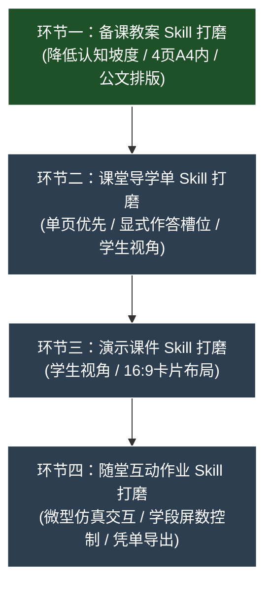

# IT Lesson Studio - 工作上下文与交接文档 (AGENTS.md)

> **给接手项目的 AI Assistant**：  
> 本项目已完成工程基建、Docker 部署与分支整理。当前主要任务是：**逐步打磨四个教学环节的 Skills，使生成的内容符合一线教学实际。**

---

## 1. 项目背景与交付物

- **定位**：面向浙江省中小学（小学 3~6 年级、初中 7~8 年级）信息科技教师的备课辅助工具。
- **四个教学环节**（具体规格以 [references/output-spec.md](references/output-spec.md) 为准）：
  1. **备课教案**：`.md` 编译为 `.docx`（四列表格、控制在 4 页 A4 内、无板书设计、包含生活比喻与设问话术）。
  2. **课堂导学单**：`.md` 编译为 `.docx`（单页优先、学生第一视角、无机房座号、含显式作答槽位）。
  3. **演示课件**：`.md` 编译为 `.pptx` 与 `.pdf`（Marp `edu-lesson` 16:9 主题、卡片布局、学生视角）。
  4. **随堂互动作业**：单文件 HTML（离线可用、微型仿真交互与即时判分、导出 `.txt` 学习凭单、通关奖状卡）。
- **基本要求**：
  - **任务同源**：同一节课的情境、任务名称与各环节作业对应一致。
  - **使用门槛低**：作业单文件离线可用，凭单文本可直接上传教学平台。
  - **符合学段特点**：遵循 2022 新课标，低年级不出现抽象代码术语。

---

## 2. 参考文档

生成或修改教学内容时参考以下文件：
1. [references/curriculum-standard-2022.md](references/curriculum-standard-2022.md)：教育部《义务教育信息科技课程标准（2022年版）》。
2. [references/textbook-zj2026.md](references/textbook-zj2026.md)：浙教版 2026 新课标教材目录（3~8 年级，共 240 课时）。
3. [references/output-spec.md](references/output-spec.md)：字数、页数、屏数、题数阈值与排版规格。
4. [references/worksheet-patterns.md](references/worksheet-patterns.md) 与 [references/patterns.md](references/patterns.md)：导学单与互动作业交互题型库。

---

## 3. 核心工具与命令

- **主 Skill**：`skills/it-lesson-studio/SKILL.md`
- **样式与模板**：
  - Word 模板与 Lua 过滤器：`resources/pandoc/模板.docx`、`resources/pandoc/br.lua`
  - Marp 演示课件主题：`resources/themes/edu-lesson.css`
- **编译导出流水线**：
  ```bash
  node scripts/export-lesson.mjs <课程目录或Markdown文件路径>
  ```
- **合规自检脚本**（Python 执行统一使用 `uv run python`）：
  ```bash
  uv run python scripts/check_lesson.py <课例目录 或 作业HTML 或 导学单Markdown>
  ```
- **标杆课例自检**：
  ```bash
  uv run python scripts/check_lesson.py examples/
  ```

---

## 4. 分支说明与前期概况

### 分支约定
- **`main` 分支**：Docker 服务器版，运行在内网或云端（如 `192.168.2.99:3800`），含多用户、鉴权与管理后台，不包含 Windows 便携脚本。
- **`feature/standalone-portable` 分支**：Windows 便携离线版，包含独立运行时与一键启动脚本。

### 前期已完成事项
- Word 排版处理（跨 Run `[ ]` 替换、四列表格跨页、缩进处理）。
- Web 界面与 Docker 容器化配置。
- 三年级、六年级、八年级标杆课例落地（位于 `examples/`，自检 0 FAIL / 0 WARN）。

---

## 5. 任务规划：打磨四大 Skills

当前重点按顺序逐一打磨四个环节，提升生成内容的实用性：



---

### 环节一：备课教案 (Lesson Plan) 打磨（进行中）
- **优化目标**：避免套话和空洞表述，为教师提供实在的课堂教学抓手。
- **具体任务**：
  - [ ] **精细化提示词梳理**：理清教案专属提示词，避免与课件、导学单互相干扰。
  - [ ] **加强三项教学支架**：
    1. **生活比喻**：对硬件、算法、网络、数据等抽象概念给出儿童易懂的比喻；
    2. **设问台词**：给出具体的主提问和追问话术；
    3. **踩坑提示**：点明学生上机易错步骤与巡视点拨建议。
  - [ ] **篇幅与排版控制**：
    - 正文字数在 2000~2800 字，Word 排版在 4 页 A4 之内；
    - 不生成板书设计与流程图；
    - 教学反思手写横线长度适中，避免折行。
  - [ ] **典型课例测试**：挑选硬件认知课、算法课、在线应用课各 1 篇，测试生成质量与排版页数。

---

### 环节二：课堂导学单 (Worksheet) 打磨（待开展）
- **优化目标**：作为轻量上机练习单，避免写成试卷，防止跨页挂孤行。
- **具体任务**：
  - [ ] **单页优先**：3~4 年级控制在 1 页 A4 单面（300~500字），高年级非大项目同样单页优先；
  - [ ] **学生视角与清晰任务**：第一人称语境，包含通关目标、操作步骤与小贴士；
  - [ ] **明确作答区域**：提供 `[ ]` 方框与记录表格，避免长篇文字作答；
  - [ ] **排版防溢出测试**：实测 Word 编译后页数稳定。

---

### 环节三：演示课件 (Marp Slides) 打磨（待开展）
- **优化目标**：适合大屏投影展示，避免大段文字或教师台词残留。
- **具体任务**：
  - [ ] **清理后台提示语**：去掉“广播听讲”、“建议用时”等非学生视角的词语；
  - [ ] **卡片与双栏布局**：合理使用 `<div class="grid-2">`、`<div class="card">` 与 `<kbd>`；
  - [ ] **一页一任务**：突出核心操作与对比，字号保持后排清晰可读；
  - [ ] **与教案导学单任务名称一致**。

---

### 环节四：随堂互动作业 (HTML Classwork) 打磨（待开展）
- **优化目标**：轻量交互仿真，操作顺畅，凭单导出不卡顿。
- **具体任务**：
  - [ ] **控制屏数与题数**：3~4 年级 ≤4 屏、测验 ≤2 题；5~6 年级 ≤5 屏；7~8 年级 ≤6 屏；
  - [ ] **丰富微型仿真交互**：卡片配对、微型解剖台、单步变量追踪等；
  - [ ] **测验统一提交判分**：先选后判，提交后锁定并显示解析；
  - [ ] **无感凭单导出**：支持免填姓名直接导出 `.txt` 凭单，提供通关奖状弹窗；
  - [ ] **确保无外部网络依赖**。

---

## 6. 测试与验证命令

完成技能优化后，使用以下命令检查：

```powershell
# 1. 检查标杆课例合规性
uv run python scripts/check_lesson.py examples/

# 2. 检查 Word 排版真实页数 (教案<=4页, 导学单1页)
uv run python scripts/verify_layout.py examples/三年级上/第02课_了解智能工具/

# 3. 运行完整编译导出
node scripts/export-lesson.mjs examples/三年级上/第02课_了解智能工具/
```
